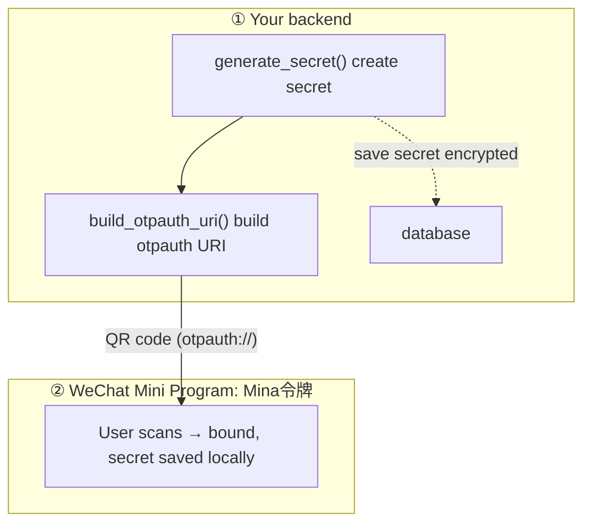
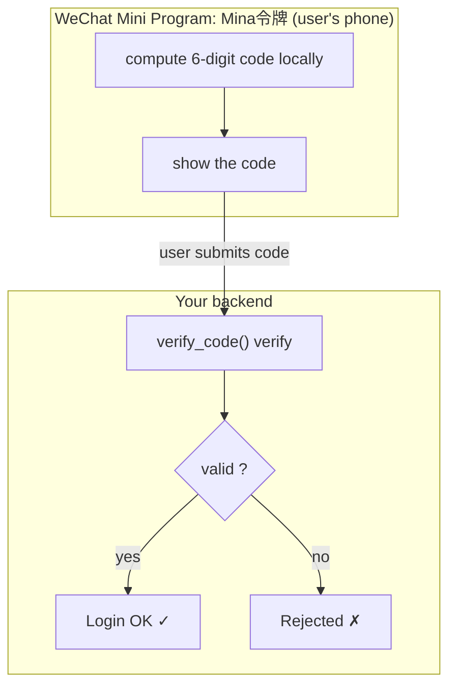

<div align="center">

# minitotp

**Standard TOTP (RFC6238) 2FA SDK · Python / Go / Node.js · Replace SMS verification codes**

English · [简体中文](./README.zh-CN.md)

[](./LICENSE)
[](https://datatracker.ietf.org/doc/html/rfc6238)
[](./TOTP-SDK/sdk/python)
[](./TOTP-SDK/sdk/go)
[](./TOTP-SDK/sdk/nodejs)

</div>

---

## What is this?

**minitotp** is a standard TOTP two-factor authentication SDK for **web service developers**: generate secrets, build otpauth QR codes, and verify 6-digit dynamic codes in your sign-up/login system. Multi-language implementations, with algorithms fully aligned to the official RFC test vectors.

**The smarter replacement for SMS verification codes.** Instead of paying for and waiting on SMS OTP, minitotp generates the same 6-digit code **locally on the user's device** — no SMS gateway, works offline, and is safer:

| SMS verification code | minitotp (TOTP) |
|---|---|
| ❌ Per-SMS cost, needs an SMS gateway | ✅ **Zero cost**, generated locally |
| ❌ Depends on carrier / signal / network | ✅ **Works offline** |
| ❌ Susceptible to SIM swap / SMS interception | ✅ **No SMS channel**, more secure |
| ❌ Requires collecting a phone number | ✅ **No phone number**, privacy-friendly |

A companion **WeChat Mini Program: Mina令牌** (a standard TOTP authenticator). After integrating minitotp, you can guide users to use this Mini Program; users are also free to use any standard TOTP authenticator (Microsoft Authenticator / Authy / Google Authenticator).


## 🚀 Live Demo

**Try it online — pure front-end, no server needed:** generate a binding QR code, watch the real-time 6-digit code, and verify it, all in your browser.

👉 **[Open the Live Demo](https://Andy8-jing.github.io/minitotp/)**

Scan the demo QR with the **WeChat Mini Program: Mina令牌** to bind & verify. Your own project can also use this Mini Program for 2FA — scan, bind, and it works offline.

## Directory structure

```
TOTP-SDK/                  # This repository
├── sdk/
│   ├── python/            # Pure standard-library implementation
│   ├── go/                # Go implementation + tests
│   └── nodejs/            # Node.js implementation + tests
├── demo-site/             # Express demo site (bind + verify flow)
├── docs/
│   └── integrate.md       # Third-party integration guide
└── LICENSE                # MIT
```

## Features

✅ **Standard protocol**: RFC4226 (HOTP) / RFC6238 (TOTP), otpauth:// — interoperable with all standard authenticators
✅ **Cross-language consistency**: all three SDK implementations are aligned and pass the RFC6238 official vectors
✅ **Cryptographically secure**: secrets generated with OS CSPRNG; SDK stores nothing — storage is the business party's responsibility
✅ **Lightweight & dependency-free**: Python/Go core has zero third-party dependencies

## Quick start (Node.js)

```bash
cd sdk/nodejs && npm install && node test.js
```

```js
const totp = require("minitotp");
const secret = totp.generateSecret(160);                       // generate a base32 secret
const uri = totp.buildOtpauthUri("MySite", "user@example.com", secret); // build otpauth URI
const ok = totp.verifyCode(inputCode, secret, 1);              // verify the 6-digit code
```

## Quick start (Python)

Install from PyPI — no third-party dependencies, pure standard library:

```bash
pip install minitotp
```

```python
from minitotp import generate_secret, build_otpauth_uri, verify_code
secret = generate_secret()                                     # generate a base32 secret
uri = build_otpauth_uri("MySite", "user@example.com", secret)  # build otpauth URI
ok = verify_code(input_code, secret, 1)                        # verify the 6-digit code
```

### End-to-end example (copy & run)

A self-contained flow covering **backend → authenticator/front-end → backend**. Copy it, `pip install minitotp`, and run:

**Enrollment flow — first-time 2FA setup:**



**Login flow — every sign-in:**



```python
from minitotp import generate_secret, build_otpauth_uri, verify_code

# ① Backend (your server): enable 2FA → secret + otpauth URI (turn into a QR for the user to scan)
secret = generate_secret()
uri = build_otpauth_uri("MySite", "user@example.com", secret)
print("Binding URI:", uri)   # this is what the user scans with an authenticator (e.g. Mina令牌 Mini Program)

# ② The authenticator computes the 6-digit code — NOT your backend. In production the
#    backend never runs calc_totp; shown below only to illustrate the code the user sees.
#    Your users actually use the **WeChat Mini Program: Mina令牌**: after scanning the QR
#    to bind, it shows the code automatically — no backend involved.
from minitotp import calc_totp
code = calc_totp(secret)
print("Authenticator shows:", code)

# ③ Backend (your server): verify the code the user submits at login
print("Backend verify:", "PASS" if verify_code(code, secret) else "FAIL")
```

## Integration steps

1. User enables 2FA: backend calls `generateSecret()` + `buildOtpauthUri()` to create the QR code
2. User scans it with the Mina令牌 Mini Program (or any standard authenticator) to bind
3. At login, user submits a 6-digit code and the backend verifies it with `verifyCode()`

> Full integration guide: [`TOTP-SDK/docs/integrate.md`](./TOTP-SDK/docs/integrate.md)

## Security notice

> The secret is the root of the credential — the business party must store it encrypted.

## Test vectors (RFC6238)

```
Secret: 12345678901234567890
T = 59           → "94287082"   (8 digits)
T = 1111111109   → "07081804"   (8 digits)
T = 2000000000   → "69279037"   (8 digits)
```

## License

[MIT License](./LICENSE)
